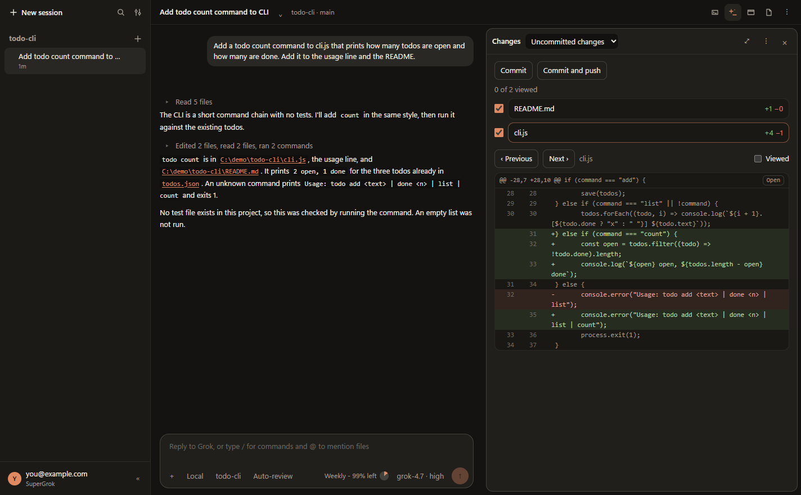

# Codewomplers Grok Desktop

Codewomplers Grok Desktop is an unofficial desktop app for the Grok CLI on Windows, macOS and Linux. It brings chat, file editing, diffs, terminals, a browser pane and pull-request tools into one app.

It runs the Grok CLI coding agent on folders on your computer. It is not a wrapper for the grok.com website.

Not affiliated with or endorsed by xAI. Grok is a trademark of its owner.



## A typical task

1. Choose **New session**, pick a project folder and describe the change. **CLI…** beside it opens a conversation started in the Grok CLI and continues that same session.
2. Grok reads and edits files in that folder. In **Normal** mode it asks before each edit or command, and you choose **Allow** or **Deny**. **Plan** mode explores and writes a plan first. **Auto-review** lets Grok's safety check approve calls, and **Always-approve** runs tools without asking. Ctrl+Shift+M opens the mode menu.
3. Open the **Changes** pane (Ctrl+Shift+D) to review the diff. Click **+** beside a line to comment, then **Send to Grok** to ask for fixes.
4. Choose **Commit** or **Commit and push** to enter a message and commit the checked files directly, or hand the commit to Grok. With the GitHub CLI signed in, **Create PR** opens a pull request and **Merge when ready** merges it when its checks pass.

The **+** menu's **Context from another chat** attaches up to three earlier chats, including archived ones, to the message being written. Grok receives a labelled snapshot of each conversation, with the newest part kept when it is long. The chat shows your text and a chip for each source, not the snapshot.

The **Files**, **Terminal** and **Browser** panes sit beside the chat for editing by hand, running commands and checking a dev server.

Browser control is off by default. Enable **Settings > Let Grok use the Browser pane** to let Grok read pages and use navigate, click, fill, select and scroll in the current session's active tab. Grok uses your Browser-pane sign-ins, and what it reads goes to xAI as part of the conversation. Other sites ask for permission even in Always-approve; sensitive fields always ask separately.

Grok's Problems tool includes only entries from the current page's origin. The pane keeps its full history for you to review.

The Browser pane shows each browser call with **Stop**. Stop blocks later browser calls immediately, but an already-sent action may still finish. A timed-out action has an uncertain outcome; browser calls stay blocked until it settles or the page navigates or closes. **Browser menu > Let Grok use this browser** resumes a stopped session.

Save reusable composer text from the **+** menu, insert it at the cursor with **Saved prompts** (Ctrl+Shift+P; Cmd+Shift+P on macOS), and rename, edit or delete it in **Settings → Saved prompts**. Inserting never sends the message.

## Requirements

- Windows 10 or 11, macOS, or a 64-bit Linux desktop.
- Node.js 22.12 or later when running from source. Release downloads include their runtime.
- Git 2.31 or later. On Windows and macOS the app's setup check installs it.
- The Grok CLI, signed in. On Windows and macOS the app's setup check installs it. If it is installed somewhere else, set `GROK_PATH` to its full executable path.
- GitHub CLI (`gh`), optional, for pull-request features. Sign in with `gh auth login` to use them.

An xAI API key can stand in for `grok login`. Choose **xAI API key** under **Settings > General > Sign-in**. The key is encrypted with the system keyring and never shown. Saving it signs out of Grok first, after asking, because a saved sign-in wins over a key. You can instead set `XAI_API_KEY` in the environment this app starts with: a user environment variable, or the terminal you launch the app from. The setup check says when a key is in use.

Behind a proxy, set `HTTPS_PROXY` or `HTTP_PROXY`, and `NO_PROXY` for hosts that bypass it. A company certificate can be named in `NODE_EXTRA_CA_CERTS`. The app passes these through to Grok. The setup check shows the proxy's scheme, host and port, without a user name or password, and whether the certificate file is there.

Download the app for your platform below, or run it from this repository if you prefer a source install.

To check a download, run `Get-FileHash <file> -Algorithm SHA256` on Windows, `shasum -a 256 <file>` on macOS, or `sha256sum <file>` on Linux, replacing `<file>` with the downloaded file's name. Compare the result with its line in `SHA256SUMS.txt` on the release page.

## Install on Windows

Download [Codewomplers-Grok-Desktop-Setup.exe](https://github.com/schmidtc63/grok-desktop/releases/latest) from the latest release and run it. Windows says it protected your PC because the app isn't signed: click More info, then Run anyway.

Or run this in PowerShell, which shows no warning:

```powershell
irm https://raw.githubusercontent.com/schmidtc63/grok-desktop/main/scripts/install-windows.ps1 | iex
```

Either one puts Codewomplers Grok Desktop in `%LOCALAPPDATA%\Programs` and adds a Start menu shortcut. It doesn't need Node.js. Open it from the Start menu.

The first launch opens the setup check. **Install Grok CLI** installs Grok and its Git. The first message opens Grok's sign-in.

### Plain install on Windows

The same app can be installed from this repository. This needs Git, the Grok CLI and Node.js.

1. Install Git from [git-scm.com](https://git-scm.com/download/win) if `git` is not already available in PowerShell. The app uses Git for its file list, diffs and branches.
2. Install the Grok CLI: `irm https://x.ai/cli/install.ps1 | iex`, then sign in.
3. Install Node.js from [nodejs.org](https://nodejs.org). In PowerShell:

```powershell
git clone https://github.com/schmidtc63/grok-desktop.git
cd grok-desktop
npm install
npm run desktop
```

Start a copy installed this way with `npm run desktop` from its folder each time.

## Install on macOS

Download the disk image for your Mac from the [latest release](https://github.com/schmidtc63/grok-desktop/releases/latest): `Codewomplers-Grok-Desktop-mac-arm64.dmg` for Apple silicon, or `Codewomplers-Grok-Desktop-mac-x64.dmg` for Intel. Open it and drag the app to Applications.

The first time, macOS blocks the app because it isn't signed: open System Settings > Privacy & Security and click Open Anyway.

Or run this in Terminal, which shows no warning:

```bash
curl -fsSL https://raw.githubusercontent.com/schmidtc63/grok-desktop/main/scripts/install-mac.sh | bash
```

The command puts Codewomplers Grok Desktop in Applications, or in `~/Applications` when you can't write to Applications. Open it from Launchpad, Spotlight or the Dock. It doesn't need Node.js.

The first launch opens the setup check. **Install Grok CLI** installs Grok. **Install Git** opens Apple's window, which installs the Command Line Tools, including Git. The first message opens Grok's sign-in.

The app isn't signed by Apple. A copy installed by the Terminal command carries no download mark, so macOS opens it without the "can't be verified" block. A copy from the disk image needs Open Anyway, as above. Each update is a new build, so macOS may ask again for access to folders such as Documents.

### Run from source on macOS

For working on the app itself, install Git with the Xcode Command Line Tools (`xcode-select --install`) or Homebrew, install the Grok CLI with `curl -fsSL https://x.ai/cli/install.sh | bash` and sign in, and install Node.js from [nodejs.org](https://nodejs.org) or Homebrew as well, then in Terminal:

```bash
git clone https://github.com/schmidtc63/grok-desktop.git
cd grok-desktop
npm install
npm run desktop
```

Start a copy run from source this way each time, from Terminal in its folder. Started like that, it finds the tools on your PATH, such as Homebrew's `git`, `gh` and `code`. Keeping its icon in the Dock and starting it from there opens plain Electron instead. While it runs from source, the menu bar names the app "Electron".

Shortcuts use Cmd where Windows uses Ctrl, except Ctrl+Tab, Ctrl+Shift+Tab and Ctrl+`, which macOS keeps for itself with Cmd.

## Install on Linux

Download the Linux x64 `.deb` or `Codewomplers-Grok-Desktop-linux-x64.tar.gz` from the [latest release](https://github.com/schmidtc63/grok-desktop/releases/latest). Both include Electron and need no separate Node.js install. Install Git with your package manager and install the Grok CLI with `curl -fsSL https://x.ai/cli/install.sh | bash`, then sign in.

### Debian or Ubuntu package

In the folder containing the downloaded `.deb`, run:

```bash
sudo apt install ./codewomplers-grok-desktop_*_amd64.deb
```

This installs the app under `/opt/codewomplers-grok-desktop`, its desktop menu entry and icon, and the `codewomplers-grok-desktop` command. Installation configures the sandbox helper's root ownership and mode 4755. Open the app from your desktop menu or run `codewomplers-grok-desktop`. To remove it, run `sudo apt remove codewomplers-grok-desktop`.

### Tar archive

Electron needs GTK 3, NSS, ALSA and GBM. On Ubuntu 24.04 and later:

```bash
sudo apt install libnss3 libgtk-3-0t64 libasound2t64 libgbm1
```

Extract the archive into a folder you want to keep, configure the sandbox helper, and start the app:

```bash
tar -xzf Codewomplers-Grok-Desktop-linux-x64.tar.gz
cd Codewomplers-Grok-Desktop-linux-x64
sudo chown root:root chrome-sandbox
sudo chmod 4755 chrome-sandbox
./codewomplers-grok-desktop
```

Repeat the sandbox commands after replacing the folder with a new release. To remove this copy, delete its extracted folder.

### Run from source on Linux

Install Node.js 22.12 or later as well. On Debian or Ubuntu, install `build-essential` and `python3` before `npm install` so node-pty can build the native terminal:

```bash
sudo apt install build-essential python3
```

If the native module cannot load, the Terminal pane falls back to pipes and says so. Then in a terminal:

```bash
git clone https://github.com/schmidtc63/grok-desktop.git
cd grok-desktop
npm install
npm run desktop
```

If `npm run desktop` stops with an error about the SUID sandbox helper (`chrome-sandbox`), which Ubuntu 24.04 and later can show, give that helper the owner and mode it needs, once after each `npm install`:

```bash
sudo chown root:root node_modules/electron/dist/chrome-sandbox
sudo chmod 4755 node_modules/electron/dist/chrome-sandbox
```

Don't start the app with `--no-sandbox`: its Browser pane loads web pages.

## Cloud sessions

A session can also run through Cursor's Cloud Agents API instead of the Grok CLI. Choose the **Cloud** environment in the New session form. The agent runs on Cursor's computers, on the folder's GitHub repository and branch.

It needs a Cursor plan with cloud agents, the repository connected to Cursor, and a Cursor API key in **Settings > General > Cursor cloud**. The key is encrypted with the system keyring. Cloud sessions use your Cursor credit. They start from what's on GitHub, so uncommitted changes and unpushed commits aren't included. There are no approval cards: the agent works on its own and can push a branch. **Open a pull request** is a per-session switch, off by default.

**My machines** runs a Cloud session on a computer you own. Choose **My machine** under **Run on**. The form shows the commands that clone the repository and start Cursor's worker, and **Settings > General > My machines** has the install and sign-in steps. The agent works with that computer's files, tools and sign-ins and can change anything its user can, so only use computers you trust and give the worker its own clone. It is told to work on a branch of its own and not to push, so its commits stay in that clone.

## Terminal

On Windows the Terminal pane and the Run buttons use PowerShell (PowerShell 7 when it is installed). On macOS and Linux they use bash. The shell starts without your profile. The native terminal supports interactive programs, colors, Ctrl+C and resizing. Run buttons open a fresh native terminal so they don't type into an existing program or unfinished command. If its native module cannot load, the pane says it is using a pipe terminal, where full-screen programs such as `vim` and `top` are unavailable. Closing the pane stops its terminals.

## Turns from local tools

In Settings > Sessions, turn on **Accept turns from local tools** to let programs on this computer that hold the private token add a message to an open session. This is off by default. Use **Copy Grok session ID** in a sidebar session's menu to get its ID after its first turn. **Export as Markdown…** in that menu saves the transcript.

A message joins that session's queue and runs with its mode and approvals. In Auto-review or Always-approve, its tool calls run without approval cards. Every inbound message starts with this line, even when the supplied text starts with a slash command:

```text
[Sent by a local tool, not typed in Grok Code]
```

While enabled, the app writes `<appData>/grok-code/inbound.json`:

- Windows: `%APPDATA%\grok-code\inbound.json`
- macOS: `~/Library/Application Support/grok-code/inbound.json`
- Linux: `$XDG_CONFIG_HOME/grok-code/inbound.json`, or `~/.config/grok-code/inbound.json` when `XDG_CONFIG_HOME` is not set.

The registry contains `{ "version": 1, "pid": 1234, "pipe": "<local pipe or socket path>", "token": "<private token>" }`. Keep the token private. Connect to `pipe` and send one JSON line, ending with a newline:

```json
{ "token": "<private token>", "agentSessionId": "<Grok session ID>", "text": "Your message" }
```

`text` must be non-empty and at most 100,000 characters. Session IDs are 1–256 letters, digits, `.`, `_`, `:` or `-`, starting with a letter or digit. The connection returns one JSON line and closes:

```json
{ "ok": true, "status": "queued" }
```

- `sent`: accepted into an idle session's queue, ready to run.
- `queued`: waiting behind an active turn or another queued message.
- `held`: the session is on hold. The message runs when you press Send now or send a message; an inbound turn does not release the hold.

These statuses confirm acceptance, not that Grok has answered. A rejected request returns `{ "ok": false, "error": "..." }`. If a window does not answer in time, the reply is `{ "ok": false, "outcome": "unknown", "error": "Grok Code did not answer in time; the message may have been queued." }`. An unknown outcome means the message may already be queued; do not retry it automatically.

Turning the setting off closes the listener and removes the registry.

## Troubleshooting

Open Settings > Check setup, or run `/doctor`, to check Grok, its sign-in, its config files and whether a newer Grok is out, along with Git and the GitHub CLI. **Copy support report** copies a summary you can paste into an issue; it has no sign-in details.

## Update

Codewomplers Grok Desktop checks for new versions: a copy run from source asks its git origin, and an installed copy on Windows or macOS asks GitHub. When one is out, the account button at the bottom of the sidebar says Update available. Open its menu and choose Update. A copy run from source on Windows closes, updates and opens again.

On Windows, quit the installed app and run the install command again. To install an older release instead (downloads start at v0.6.1), set its tag first: `$GrokDesktopTag = "v0.6.1"; irm https://raw.githubusercontent.com/schmidtc63/grok-desktop/main/scripts/install-windows.ps1 | iex`.

On macOS, quit the app and run the install command again. To install an older release instead (downloads start at v0.6.1), add its tag: `curl -fsSL https://raw.githubusercontent.com/schmidtc63/grok-desktop/main/scripts/install-mac.sh | bash -s -- v0.6.1`.

On Linux, quit the app and install the new `.deb`, or extract the new tar archive and repeat its sandbox setup above.

In a copy run from source on Linux or macOS, and in versions before 0.2.0, update by hand: quit the app, then in its folder run:

```bash
git pull
npm install
npm run desktop
```

If the update can't run (local changes, another branch, or your own commits), the app shows these commands instead.

If the app doesn't start after an interrupted update, run `node scripts/update-helper.cjs --recover` in its folder.

## Tests

```powershell
npm run typecheck
npm run build
npm test
```

## Contributing

Open work and ideas are listed in [TODO.md](TODO.md). Pull requests are welcome.

## License

MIT. Copyright (c) 2026 Codewomplers. See [LICENSE](LICENSE).
